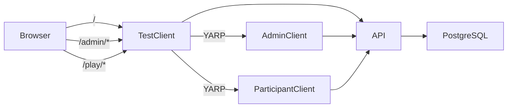

# Architektur

## Solution-Projekte

| Projekt | Verantwortung |
| --- | --- |
| `WeihnachtsfeierBit.ApiService` | HTTP-API, Login, Projektberechtigungen und EF-Core-Migrationen beim Start |
| `WeihnachtsfeierBit.AdminClient` | Server-seitiger Blazor-Client mit Admin-Login, Projektverwaltung, Workspace-Sidebar, globaler Show-Bibliothek und projektspezifischen Show-Verknüpfungen |
| `WeihnachtsfeierBit.ParticipantClient` | Server-seitiger Blazor-Client für Teilnehmer unter `/play/{projectId}` mit Nummern-Login, mobilem/desktop-optimiertem Team-Dashboard und SignalR Live-Anbindung |
| `WeihnachtsfeierBit.Framework` | Rollenübergreifender Razor-Class-Library-Baustein mit generischen UI-Primitiven, API-Client und gemeinsam genutzten Verträgen; enthält keine Admin-/Projektseiten |
| `WeihnachtsfeierBit.Web` | Entwicklungs-/Testclient; proxyt `/admin` per YARP an den AdminClient und `/play` an den ParticipantClient |
| `WeihnachtsfeierBit.Data` | EF-Core-Entities, PostgreSQL-Mappings und Migrationen |
| `WeihnachtsfeierBit.ServiceDefaults` | Aspire Service Discovery, Health Checks, Resilience und Telemetrie |
| `WeihnachtsfeierBit.AppHost` | Lokale Aspire-Orchestrierung |

## Laufzeit

`WeihnachtsfeierBIT/docker-compose.yml` startet PostgreSQL, API, Testclient und Adminclient als Container. Am Host veröffentlicht sind Testclient `8080`, API `8081` und PostgreSQL ausschließlich auf `127.0.0.1:5432`. Der Adminclient-Port bleibt intern; `/admin` wird vom Testclient weitergeleitet. Aspire beschreibt denselben Dienstgraphen für lokale Entwicklung.

`WeihnachtsfeierBit.Data` und `WeihnachtsfeierBit.ServiceDefaults` sind Bibliotheken und laufen nicht als eigene Container. `Hitster/` gehört nicht zu diesem Dienstgraphen.

## Codepfade

- API-Komposition & SignalR Hubs: `WeihnachtsfeierBit.ApiService/Program.cs` (`GameStateHub` unter `/hubs/gamestate`), Hintergrund-Worker `ScheduledEventsBackgroundService.cs` für automatische Event-Starts.
- Routenmodule: `WeihnachtsfeierBit.ApiService/Endpoints/`
- Authentifizierung und Projektfilter: `WeihnachtsfeierBit.ApiService/Auth/`
- Request-/Response-Verträge: `WeihnachtsfeierBit.ApiService/Contracts/`
- Entities und Mapping: `WeihnachtsfeierBit.Data/`
- Admin-Routen, Fachansichten, Sidebar und Adminformulare: `WeihnachtsfeierBit.AdminClient/`
- Teilnehmer-Client (`/play/{projectId}`): `WeihnachtsfeierBit.ParticipantClient/`
- Generische UI-Primitiven und gemeinsame API-Adapter: `WeihnachtsfeierBit.Framework/`
- Testclient und Proxy: `WeihnachtsfeierBit.Web/`

Fachlogik gehört in Endpoint-/Serviceklassen, nicht in `Program.cs` oder Razor-Komponenten. Fachansichten und Navigation bleiben im jeweiligen Client; nur zweckneutrale UI-Primitiven und wiederverwendbare API-Verträge liegen im Framework. Weitere Oberflächen wie Teilnehmerclient und Leinwand-Dashboard sollen später eigenständige Clients sein und können dieselbe Framework-Bibliothek verwenden.

## Produktgrenzen

Vereinheitlichtes Event-Modell, Admin-Verwaltung, Live-Showausführung, spontanes Moderieren, zeitliche Event-Planung & Auto-Start, Event-Sichtbarkeitssteuerung, freie Teilnehmer-Navigation (`self_paced`), Beamer-Fokussierung (`ActiveCanvasEventId`), SignalR-Echtzeitsynchronisation sowie mobiler Teilnehmer-Client sind vollständig umgesetzt. Das Leinwand-Dashboard (Projektor-Anzeige) ist der nächste geplante Schritt. Siehe [Produktvision und Rollen](product-and-roles.md).