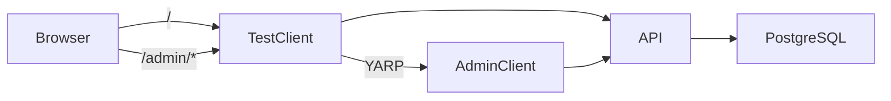

# Architektur

## Solution-Projekte

| Projekt | Verantwortung |
| --- | --- |
| `WeihnachtsfeierBit.ApiService` | HTTP-API, Login, Projektberechtigungen und EF-Core-Migrationen beim Start |
| `WeihnachtsfeierBit.AdminClient` | Separater serverseitiger Blazor-Client für globalen Admin-Login, Registrierung, Logout und Dashboard |
| `WeihnachtsfeierBit.Web` | Entwicklungs-/Testclient; proxyt `/admin` per YARP an den AdminClient |
| `WeihnachtsfeierBit.Data` | EF-Core-Entities, PostgreSQL-Mappings und Migrationen |
| `WeihnachtsfeierBit.ServiceDefaults` | Aspire Service Discovery, Health Checks, Resilience und Telemetrie |
| `WeihnachtsfeierBit.AppHost` | Lokale Aspire-Orchestrierung |

## Laufzeit

`WeihnachtsfeierBIT/docker-compose.yml` startet PostgreSQL, API, Testclient und Adminclient als Container. Am Host veröffentlicht sind Testclient `8080`, API `8081` und PostgreSQL ausschließlich auf `127.0.0.1:5432`. Der Adminclient-Port bleibt intern; `/admin` wird vom Testclient weitergeleitet. Aspire beschreibt denselben Dienstgraphen für lokale Entwicklung.

`WeihnachtsfeierBit.Data` und `WeihnachtsfeierBit.ServiceDefaults` sind Bibliotheken und laufen nicht als eigene Container. `Hitster/` gehört nicht zu diesem Dienstgraphen.

## Codepfade

- API-Komposition: `WeihnachtsfeierBit.ApiService/Program.cs`
- Routenmodule: `WeihnachtsfeierBit.ApiService/Endpoints/`
- Authentifizierung und Projektfilter: `WeihnachtsfeierBit.ApiService/Auth/`
- Request-/Response-Verträge: `WeihnachtsfeierBit.ApiService/Contracts/`
- Entities und Mapping: `WeihnachtsfeierBit.Data/`
- Adminoberfläche und API-Adapter: `WeihnachtsfeierBit.AdminClient/`
- Testclient und Proxy: `WeihnachtsfeierBit.Web/Program.cs`

Fachlogik gehört in Endpoint-/Serviceklassen, nicht in `Program.cs` oder Razor-Komponenten. Weitere Oberflächen wie Teilnehmerclient und Leinwand-Dashboard sollen später eigenständige Clients sein.

## Produktgrenzen

Datenmodell, Login und CRUD-Grundlagen existieren. Live-Showzustand, Antworten, Punktehistorie, Teilnehmerclient und Leinwand-Dashboard fehlen noch. Siehe [Produktvision und Rollen](product-and-roles.md).